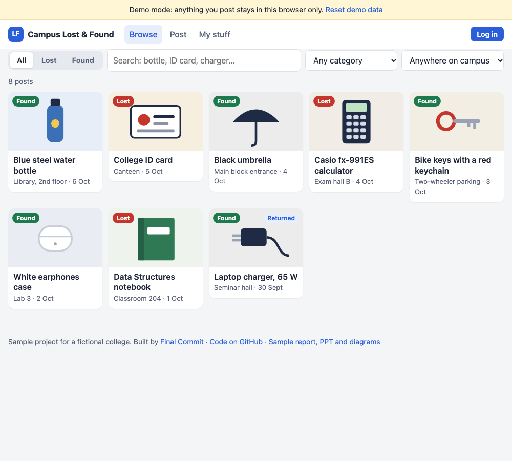

# Campus Lost & Found: live demo

**Try it:** https://finalcommitprojects.github.io/demo-lost-found/

Post, search and claim lost items with a proof question, then arrange the hand-over in messages. The live demo keeps its data in your browser.

This repository only hosts the live demo, so the JavaScript here is bundled and minified. The full source code, with the setup or training scripts, tests, documentation and the project report, comes with the project when you take it with [Final Commit](https://finalcommitprojects.github.io/?utm_source=github&utm_campaign=demo-lost-found).

The [`samples/`](samples/) folder has the sample synopsis, report chapter, presentation, viva questions and diagrams for this project.

© 2026 Final Commit. All rights reserved.
